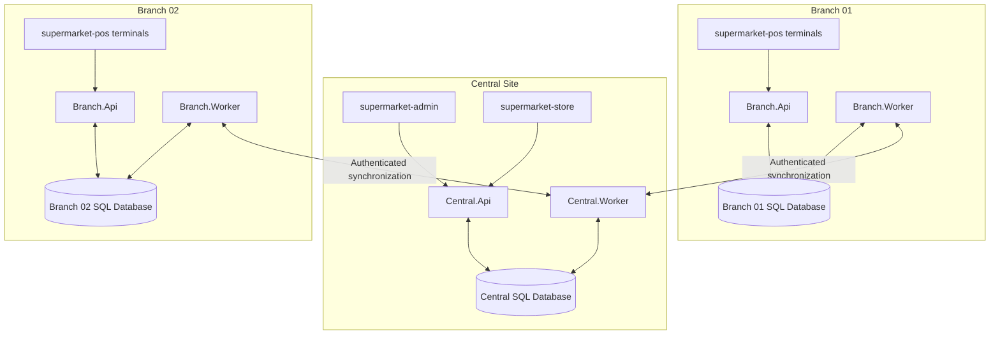

# Technical Design — Architecture Overview

**Document:** TD-01  
**Version:** 0.1  
**Status:** Approved by project owner — architecture baseline accepted (2026-11-06)  
**Source of truth:** Merged BRS in `master`, approved discovery decision log, and explicit owner decisions.  
**Scope:** System boundaries, deployable applications, runtime responsibilities, data ownership principles, and communication paths.

## 1. Design goals

1. Preserve the approved central governance model and branch operational autonomy within the approved Offline policy.
2. Keep POS operations local to the branch so a temporary internet outage does not stop permitted branch sales.
3. Prevent a branch from selling when its local Branch API/server is unavailable.
4. Keep the central and branch responsibilities explicit and auditable.
5. Avoid premature microservice complexity for the initial 3–5 branch deployment.
6. Support safe synchronization, retries, conflict isolation, and idempotent processing.
7. Keep business rules in backend application layers; Angular clients must not connect directly to databases.

## 2. Architecture decision

Use a **distributed Modular Monolith** with two backend application types:

- **Central application:** one Central API host and one Central Worker host.
- **Branch application:** one Branch API host and one Branch Worker host per branch.

Each API is internally modular, with modules aligned to business capabilities. Modules are not deployed as independent microservices in the initial release.

This is a deployment boundary decision, not a final code-folder structure. The detailed module dependency rules will be specified separately.

## 3. Logical system components

| Component | Deployment scope | Main responsibility |
|---|---|---|
| `Central.Api` | Central site | Central administration, employees/permissions, products, suppliers/purchasing governance, master data, prices/promotions, central approvals, online order orchestration, central reports, and external-facing API endpoints. |
| `Central.Worker` | Central site | Background processing, central outbox/inbox handling, branch synchronization coordination, payment-provider event processing, notifications, scheduled policies, and retryable jobs. |
| `Branch.Api` | Each branch | Local POS operations, cashier shifts, branch inventory operations, receiving confirmations, assigned online-order preparation, pickup/delivery handover workflows, and local read/write operations allowed by branch policy. |
| `Branch.Worker` | Each branch | Local background jobs, local outbox/inbox, synchronization submission/reception, retry/resume, connectivity heartbeat, and local data refresh. |
| `supermarket-pos` | Branch terminals | Angular POS client; communicates only with the Branch API of its own branch. |
| `supermarket-store` | Customer devices | Angular online store; communicates with Central API. |
| `supermarket-admin` | Authorized central users | Angular central administration client; communicates with Central API. |
| Central SQL database | Central site | Central-owned records, authoritative master data, central approvals, online orders, consolidated views, and synchronization state. |
| Branch SQL database | Each branch | Local branch operational data, local POS transactions, branch stock state, cached centrally approved data, and pending synchronization records. |

The Central API and Worker share the central application/database boundary. The Branch API and Worker share the branch application/database boundary. Workers are separate host processes so background work does not depend on an API request remaining open.

## 4. Logical topology

The diagram is logical. It does not yet specify network hardware, hosting provider, VPN, reverse proxy, ports, DNS, or high-availability topology.

## 5. Core communication rules

1. POS terminals communicate with their own branch's Branch API over the branch local network.
2. The POS client never connects directly to SQL Server.
3. The online store and central administration client communicate with Central API over HTTPS.
4. Branch Worker exchanges synchronization messages with Central Worker/API through authenticated application endpoints.
5. No branch or central database is exposed for direct cross-site database access.
6. Central-to-branch synchronization must not require the central application to execute SQL statements against a branch database.
7. External payment-provider callbacks are received and validated by the central backend; browser return URLs alone are not proof of payment.
8. Background work is performed by Worker hosts, not by long-running tasks attached to HTTP requests.

## 6. Data authority and Offline behavior

- Central Administration is the authoritative source for centrally managed data and policies.
- A branch stores the latest centrally approved data needed for its local operations.
- Each branch maintains its own branch stock and local operational records; one branch's stock is not directly shared with another branch.
- During a permitted internet outage, the branch uses its latest approved local copy of prices and promotions. An expired promotion stops applying and the approved base price is used.
- The Offline duration is centrally configurable and applies uniformly to all branches.
- Local login validity is limited to 24 hours after the last successful central verification.
- When the approved Offline duration expires, the branch stops new sales and invoice issuance. Restoring connectivity alone does not resume sales.
- Synchronization resumes from the last successful point, does not duplicate operations, isolates conflicts, and continues unrelated valid operations.
- The branch resumes sales only after all required operations are acknowledged, conflicts/failures are resolved, reconciliation and data refresh are complete, and Central Administration explicitly authorizes resumption.

The detailed ownership matrix, synchronization message contract, conflict categories, and reconciliation sequence are separate design deliverables.

## 7. Consistency and reliability principles

- Use an Outbox pattern for durable publication of committed local/central business operations.
- Use an Inbox or equivalent processed-message ledger to detect previously handled messages.
- Every synchronizable operation has a stable `OperationId` used for idempotency across retries.
- A message is acknowledged only after its durable processing result is recorded.
- Retryable transport failures must not create duplicate sales, stock movements, payments, or refunds.
- Business conflicts are not silently overwritten or auto-resolved; they are isolated and referred to Central Administration.
- A conflict must not block unrelated valid synchronization work.
- Historical invoices and financial records retain their original transaction values.

## 8. Initial deployment boundaries

- One central application deployment and one central database.
- One branch application deployment and one branch database per branch.
- POS devices connect only to the local branch application.
- The central applications are shared by the chain; branch APIs/databases are isolated by branch.
- The initial design targets 3–5 branches and the approved initial business scale. Capacity sizing and hardware sizing are later tasks.

Whether the Branch API/Worker run on a dedicated physical server, a virtual machine, or another managed local host remains a deployment decision. The requirement is that the local Branch API and its database remain available to branch POS devices during internet outages.

## 9. Technology decisions intentionally not finalized in TD-01

This document does not yet freeze:
- Exact .NET runtime/SDK version.
- Angular version and frontend build tooling.
- SQL Server edition/version and per-branch sizing.
- Hosting provider, operating system, and physical/virtual server specifications.
- Authentication protocol details, token lifetime beyond the approved local verification rule, key management, and secret storage.
- API versioning format and synchronization transport protocol.
- Payment gateway, email/push provider, monitoring/logging products, and backup product.
- Detailed database schema, module boundaries at code level, and CI/CD pipeline.

These are addressed in the next technical-design decisions, using compatibility, lifecycle support, operational cost, and the approved business requirements as evaluation criteria.

## 10. Risks and controls to resolve in detailed design

| Risk | Required design control |
|---|---|
| Local Branch API or database failure | Local monitoring, service recovery, tested branch backup/restore, and clear POS unavailable behavior. |
| Central connectivity loss | Continue only within centrally approved Offline duration and local policy. |
| Duplicate synchronization | Stable OperationId, durable Inbox/Outbox, and idempotent handlers. |
| Partial synchronization | Checkpointed resumable batches and per-operation outcomes. |
| Conflicting stock or master data | Conflict isolation, central review, and explicit approval. |
| Unauthorized branch access | Central role/permission governance, branch scoping, authentication, and audit. |
| Central outage | Central backup/recovery design must meet approved RPO 15 minutes and RTO 4 hours. |

## 11. Next technical-design deliverables

1. Technology stack and supported runtime/version selection.
2. Backend modular boundaries and dependency rules.
3. Database topology and data ownership matrix.
4. Synchronization contract, message lifecycle, and conflict handling.
5. Authentication, authorization, and security design.
6. API boundaries and external integration design.
7. Deployment, backup, monitoring, and recovery design.
8. Architecture decision records (ADRs) for choices that materially affect implementation.

## 12. Approval boundary

TD-01 establishes the initial logical architecture from approved project decisions. It does not authorize application coding or freeze technology versions. The next deliverable evaluates and records the technology stack before detailed schema/API design.
