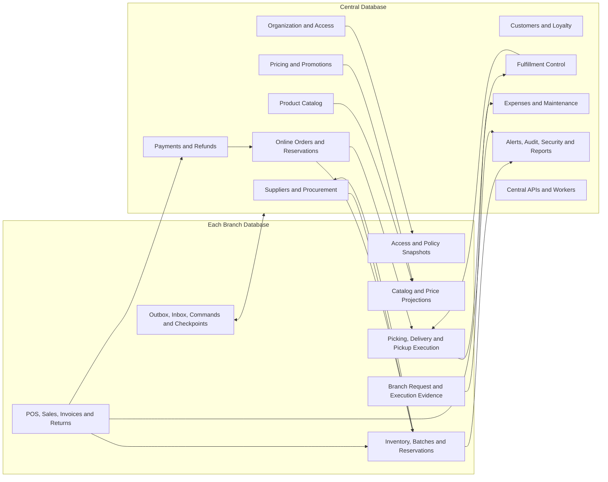

# TD-24 — Comprehensive Database Schema Consistency Review and ERD Baseline

**Version:** 0.2  
**Status:** Revised for owner review after TD-29  
**Date:** 2026-11-07  
**Scope:** Cross-document verification of TD-13 through TD-23 against TD-12 and the approved BRS/decision baseline.  
**Purpose:** Confirm table inventory coverage, primary-key convention, ownership, relationships and implementation boundaries before producing the final module ERDs and physical schema package.

## 1. Review result

The logical database design is now organized into a complete inventory, a relationship catalogue and detailed module schemas. This review checks that these documents agree with each other; it does not create or modify business policy.

| Review item | Result |
|---|---|
| TD-13 inventory rows | 211 unique entries |
| Synchronization infrastructure tables | 5, specified physically in TD-12 |
| Domain table candidates | 206 |
| Domain tables with detailed schema in TD-15–TD-23 | 205 |
| Payroll tracking | 1 Central placeholder; intentionally not column-designed until the approved FIN-03 scope is mapped |
| Relationship references in TD-14 | All referenced domain tables exist in TD-13 |
| Primary-key declarations in TD-15–TD-23 | 205 checked; all `uniqueidentifier` |
| Synchronization PK declarations in TD-12 | 5 checked; all `uniqueidentifier` |
| Malformed Markdown table rows in reviewed schemas | None found in this review |
| Cross-database SQL foreign keys | Prohibited; cross-site references are GUID correlations/contracts |

**Conclusion:** The inventory, ownership and detailed schema documents are internally aligned at the logical design level. All 210 fully specified tables (205 domain + 5 synchronization) follow the Guid PK rule. Payroll remains a named placeholder, not an approved detailed payroll schema.

## 2. Documents covered

| Document | Purpose | Review result |
|---|---|---|
| TD-12 | Physical SQL Server schema for durable synchronization | Five infrastructure tables; Guid PK convention |
| TD-13 | Complete candidate table inventory | 211 unique entries; no generic reporting-read-model pseudo-table |
| TD-14 | Logical relationships/cardinalities and local FK boundaries | All referenced domain tables resolve to TD-13 |
| TD-15 | Organization, employee, identity integration and access snapshots | Detailed |
| TD-16 | Product catalog | Detailed |
| TD-17 | Suppliers and procurement | Detailed |
| TD-18 | Inventory and stock | Detailed, including stock-increase requests and stocktake session events |
| TD-19 | Pricing, promotions and coupons | Detailed |
| TD-20 | POS, sales, invoices, returns and exchanges | Detailed |
| TD-21 | Payments, refunds and reconciliation | Detailed |
| TD-22 | Online orders, customer, loyalty and fulfillment | Detailed |
| TD-23 | Expenses, payroll boundary, cash deposits, maintenance, alerts, audit and reporting | Detailed except payroll placeholder |

The old `reporting.*ReadModels` inventory row was removed because it described a family of derived query projections, not one concrete relational table. Read models remain part of the reporting design but are not counted as physical business tables.

## 3. Primary-key and foreign-key audit

### 3.1 Primary keys

- All detailed domain tables use `Guid` in C# and `uniqueidentifier` in SQL Server.
- The five TD-12 synchronization tables also use `Guid` / `uniqueidentifier`.
- Integer identity primary keys are not permitted.
- Integer/`bigint` columns remain valid for counters, version numbers, sequence values, attempt numbers and ordering; they are not primary keys.
- All FKs use the same Guid type as the referenced PK.
- EF Core SQL Server sequential Guid generation remains the implementation convention, as recorded in TD-12 and the system-wide design rules.

### 3.2 Foreign-key boundaries

- SQL FKs are allowed only within the same physical database.
- Central-to-Branch and Branch-to-Central relationships use stable GUID references, approved API contracts and synchronization messages.
- No Central database query or FK may reach into a Branch database.
- A Branch may hold local read-only projections of centrally owned master data; those projections do not become independent authorities.
- Historical transactions retain GUID references and immutable snapshots even when a master record is deactivated or changed.

## 4. Ownership consistency

| Data domain | Authoritative owner | Branch behavior |
|---|---|---|
| Branches, employees, roles, permissions, device registration | Central | Local access/device/policy snapshots only |
| Product catalog, product availability, supplier master | Central | Read-only approved projections |
| Purchase requests/approvals/orders | Central | Branch request origin and physical receiving facts |
| Physical stock, batches, movements, reservations | Each Branch | Branch owns only its own physical stock |
| Prices, promotions, coupons | Central | Approved versioned local snapshots; no local edits |
| POS invoices, shifts, cash drawer | Each Branch | Central immutable synchronized history |
| Online orders and checkout reservations | Central | Assigned-order projection and local stock reservation acceptance |
| Payment provider config/events and online payment | Central | POS transaction origin remains Branch-correlated |
| Customer profile, OTP, loyalty authority and complaints | Central | Minimum assigned customer/loyalty projection only |
| Picking, delivery attempt, pickup and physical return-to-branch facts | Branch execution | Central assignment, policy, dispute and review authority |
| Expenses | Central approval/review | Branch request/execution origin |
| Payroll tracking | Central | No Branch copy |
| Cash deposits | Central | Branch shift/reconciliation facts are referenced |
| Maintenance | Central workflow/assignment/closure | Branch request and operational confirmation |
| Alerts, audit, security review and management reports | Central authority; Branch local event origin where applicable | Local audit/security events synchronize to Central |

## 5. Logical ERD — module and database boundaries

This is the module-level ERD baseline. TD-14 contains the detailed table-level parent/child cardinalities. Arrows below mean controlled data publication, API/command or event synchronization; they do not represent cross-database SQL FKs.

### 5.1 Transaction ownership

- POS sale completion is atomic within the Branch database for invoice, stock issue, payment allocation and Outbox record. Online provider payments are verified centrally; an independent POS bank-terminal result is recorded by the cashier and is not represented as automated provider verification.
- Online order confirmation is Central-owned; Branch stock reservation is a separate local atomic operation and must be acknowledged before the order proceeds.
- Stocktake freeze/adjustment, transfer, excess receiving, disposal, cancellation and refund-method exception use Central decisions followed by authenticated Branch commands where physical Branch state must change.
- No distributed SQL transaction is assumed. Outbox/Inbox, OperationId idempotency and durable acknowledgements provide cross-site recovery.

## 6. Cross-document corrections completed during consistency review

The following mismatches were corrected in the documentation branch for this review:

1. Added the Central `org.RuntimePolicies` source table to match the Branch `org.BranchRuntimePolicies` projection.
2. Added `catalog.ProductBranchAvailability` and explicit relationships to Central Branch/Product masters.
3. Added `procurement.SupplierReturnTerms`, per-line purchase/receipt decision tables, supplier invoice lines, supplier return events and settlements.
4. Added `inventory.ExpiryAlertPolicies`, disposal decision lines and full table-level specifications for stock-increase requests/decisions and stocktake session events.
5. Added `pricing.PromotionVersions` so Branch promotion snapshot versions have an explicit Central publication source.
6. Added POS suspended carts, drawer reconciliation, invoice discount/cancellation records, original-batch return allocations and no-invoice return exception decisions.
7. Added payment provider configuration, refund-method exception decisions and transaction-level reconciliation lines.
8. Added customer duplicate resolution, loyalty point lots/allocations, complaint assignments, order cancellation line decisions, fulfillment exception line decisions, picking scans, failed-delivery return inspections and pickup non-collection decisions.
9. Added maintenance request events, alert actions and Central security-event reviews.
10. Removed the generic reporting read-model family from the physical table inventory and documented it as derived projections.
11. Made the one-reservation-per-order relationship explicit and clarified that accepted Branch reservations are not released by a Branch-local timer; Central sends the release command.
12. Corrected the explicit fulfillment decision-line heading and confirmed the stocktake event table has its own Guid PK.

## 7. Consolidated implementation-impacting decisions

This is the single current list of unresolved technical decisions after applying the owner-approved business decisions and merged design decisions through TD-29 and the latest POS/payment reconciliation. Items marked **Open** require owner review or a technical proposal before physical schema implementation. Items marked **Resolved** must not be reopened as business-policy questions.

### 7.1 Resolved decisions — carry forward as constraints

1. **Unified Identity:** One Central `auth.Users` ASP.NET Core Identity store with Guid keys and required `AccountType` (Employee or Customer); separate one-to-one `org.Employees` / `crm.Customers` profiles; one account cannot own both profiles. Employee roles map to `org.Roles`. The exact SQL Server cross-profile XOR enforcement mechanism remains open (see below).
2. **Independent POS bank terminal:** The bank terminal is operated independently outside the application. Cashier records the observed successful result and optional receipt/reference. No terminal API, SDK, network integration, provider event or automated bank verification.
3. **Customer refunds:** All customer refunds are paid in cash from the responsible Branch cash drawer, regardless of original tender. If the original payment included electronic tender, prior Central approval and a recorded reason are mandatory. Refunds remain linked to original successful payment transaction(s); cumulative successful refunds cannot exceed the paid amount. No provider-based customer refund execution.
4. **OTP policy:** Expiry, maximum verification attempts, resend cooldown and resend limits are fixed application-code constants, not centrally configurable. Exact numeric values and provider/security implementation details remain a security implementation specification, not a schema setting.
5. **Payroll boundary:** Central payroll tracking only; no payroll engine, attendance, leave or salary-calculation system is in scope. Detailed tracking fields remain intentionally deferred.
6. **Branch order/customer access:** Branch receives only assigned orders and the minimum approved customer/order fields needed to fulfill them; no customer-profile search/browse and no access to unassigned orders.
7. **Expense workflow:** Central approval is required before a Branch expense is executed; Branch records actual amount and supporting evidence afterward.
8. **Central cash deposits:** One Central deposit may cover multiple Branch shifts, with separately traceable shift details and duplicate prevention. Only an authorized Central employee confirms receipt and closes the deposit.
9. **Maintenance requests:** A request may be created for an unregistered device; device description and location are required.
10. **Alerts and audit:** Immediate event alerts and scheduled threshold/periodic alerts are supported; retry/failure history is retained without changing the source event. Ordinary users cannot edit/delete audit records; Central controls protected archival.
11. **Reporting:** Central relational read models are the initial reporting approach; no Data Warehouse is introduced in this scope.

### 7.2 Open technical decisions — review one at a time

1. **Identity XOR enforcement (High):** Select the SQL Server-enforced design that guarantees an Employee account has exactly one `org.Employees` profile and no `crm.Customers` profile, and vice versa. The user explicitly deferred this choice; no mechanism is selected here.
2. **Identity/session persistence (High):** Confirm which Identity relationship tables are actually required (user roles, claims, logins, tokens, role claims), token/session persistence and revocation model, while preserving the unified store and employee/customer authorization separation.
3. **Offline credential verifier (High):** Approve the threat model, cryptographic construction, key protection, revocation and lifecycle for Branch-local employee Offline authentication. Branch DB must not copy Central password hashes, security stamps or reusable Central tokens.
4. **Payment-provider idempotency (High):** Define provider-specific idempotency keys, callback ordering, duplicate/out-of-order event handling and ambiguous timeout recovery for Central online payments.
5. **Split-tender refund allocation (High):** Define how a refund amount is allocated back against the original successful payment transactions when an invoice used multiple tenders; enforce the cumulative cap per original transaction.
6. **Online-order cash refund handover (High):** Define the customer verification, responsible Branch handover, receipt/evidence and authorization steps for cash refunds of online orders after required Central approval.
7. **Offline promotion/coupon limits (High):** Define a safe quota/reservation/reconciliation strategy for cross-Branch usage while disconnected. Do not claim globally exact limits without an approved mechanism.
8. **Offline loyalty redemption (Medium):** Define local balance/quota behavior and Central reconciliation of concurrent Offline redemptions without changing the approved loyalty policy.
9. **Supplier payment allocation (Medium):** Decide whether one supplier payment/bank transfer may settle multiple supplier invoices. Current TD-17 models one payment against one invoice; if multi-invoice settlement is required, add a payment header and allocation rows before implementation.
10. **JOD rounding (Medium):** Approve the exact half-rounding tie-breaker and rounding points. Preserve internal precision and the approved two-decimal final invoice display/amount policy.
11. **Promotion rule catalogue (Medium):** Finalize allowlisted condition types/operators and reward types as versioned application contracts; no arbitrary expressions from the database.
12. **Receiving/stocktake recovery (Medium):** Define command payloads, durable acknowledgements and Branch restart recovery while scoped stock locks are active.
13. **Concurrency contracts (High):** Specify and test atomic SQL algorithms for stock reservation/issue, batch allocation, invoice sequence allocation, refund caps, shift/drawer posting and idempotent Outbox completion.
14. **Retention/privacy (Medium):** Define retention, archival, redaction and access policies for customer, financial, audit, security and attachment data.
15. **POS operational details (Medium):** Finalize invoice-number gap behavior after failed completion, return allocation across depleted/transferred batches, mixed inspection quantities, paid-cancellation compensation, decision recovery while Offline, print-document retention/versioning, and whether one cashier may hold simultaneous shifts on multiple POS devices.
16. **Reporting calculations (Medium):** Define calculation contracts and data lineage for sales, profit, inventory and Branch comparisons using actual batch costs.

### 7.3 Deliberately deferred — not a blocker for the first schema slice

- **Payroll detailed fields/tables:** remain undefined until a separate approved tracking scope exists.
- **Tax/e-invoicing engine:** placeholders only; no tax engine or provider integration.
- **Identity XOR mechanism:** remains an explicit owner decision; do not infer or implement a preferred mechanism before approval.

## 8. Readiness gate

| Gate | State |
|---|---|
| Candidate table inventory and table count | Prepared; owner review pending |
| Central/Branch ownership map | Prepared |
| Logical relationships/cardinalities | Prepared; owner review pending |
| Guid PK and local FK convention | Verified in design documents |
| Module-level ERD baseline | Prepared; must be reconciled to final owner-approved logical schema |
| Detailed domain schemas TD-15–TD-23 | Prepared; owner review pending |
| Cross-document POS refund policy (TD-20/TD-21) | Reconciled in this revision |
| Approved business decisions through TD-29 and later decision records | Carried into this consolidated list |
| Remaining implementation-impacting decisions | Listed in §7.2; require staged review |
| SQL physical deployment design, indexes and concurrency proof | Not started |
| EF Core entities/configurations | Not started |
| SQL migrations and integration tests | Not started |

**Implementation remains blocked.** Do not generate EF Core entities, DDL or migrations until the logical schema and the implementation-impacting decisions required for the relevant module are approved, TD-26 physical standards are approved, and final module ERDs are reconciled.

## 9. Approval boundary

TD-24 is a consistency review, not owner approval of TD-13–TD-23. It confirms document alignment and records remaining technical decisions. No business rule is changed, and no SQL table, EF Core entity, DDL or migration is created by this document.
