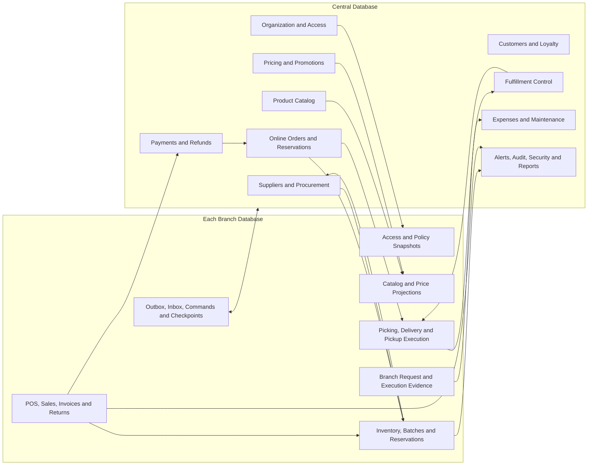

# TD-24 — Comprehensive Database Schema Consistency Review and ERD Baseline

**Version:** 0.1  
**Status:** Proposed for owner review  
**Date:** 2026-11-07  
**Scope:** Cross-document verification of TD-13 through TD-23 against TD-12 and the approved BRS/decision baseline.  
**Purpose:** Confirm table inventory coverage, primary-key convention, ownership, relationships and implementation boundaries before producing the final module ERDs and physical schema package.

## 1. Review result

The logical database design is now organized into a complete inventory, a relationship catalogue and detailed module schemas. This review checks that these documents agree with each other; it does not create or modify business policy.

| Review item | Result |
|---|---|
| TD-13 inventory rows | 211 unique entries |
| Synchronization infrastructure tables | 5, specified physically in TD-12 |
| Domain table candidates | 206 |
| Domain tables with detailed schema in TD-15–TD-23 | 205 |
| Payroll tracking | 1 Central placeholder; intentionally not column-designed until the approved FIN-03 scope is mapped |
| Relationship references in TD-14 | All referenced domain tables exist in TD-13 |
| Primary-key declarations in TD-15–TD-23 | 205 checked; all `uniqueidentifier` |
| Synchronization PK declarations in TD-12 | 5 checked; all `uniqueidentifier` |
| Malformed Markdown table rows in reviewed schemas | None found in this review |
| Cross-database SQL foreign keys | Prohibited; cross-site references are GUID correlations/contracts |

**Conclusion:** The inventory, ownership and detailed schema documents are internally aligned at the logical design level. All 210 fully specified tables (205 domain + 5 synchronization) follow the Guid PK rule. Payroll remains a named placeholder, not an approved detailed payroll schema.

## 2. Documents covered

| Document | Purpose | Review result |
|---|---|---|
| TD-12 | Physical SQL Server schema for durable synchronization | Five infrastructure tables; Guid PK convention |
| TD-13 | Complete candidate table inventory | 211 unique entries; no generic reporting-read-model pseudo-table |
| TD-14 | Logical relationships/cardinalities and local FK boundaries | All referenced domain tables resolve to TD-13 |
| TD-15 | Organization, employee, identity integration and access snapshots | Detailed |
| TD-16 | Product catalog | Detailed |
| TD-17 | Suppliers and procurement | Detailed |
| TD-18 | Inventory and stock | Detailed, including stock-increase requests and stocktake session events |
| TD-19 | Pricing, promotions and coupons | Detailed |
| TD-20 | POS, sales, invoices, returns and exchanges | Detailed |
| TD-21 | Payments, refunds and reconciliation | Detailed |
| TD-22 | Online orders, customer, loyalty and fulfillment | Detailed |
| TD-23 | Expenses, payroll boundary, cash deposits, maintenance, alerts, audit and reporting | Detailed except payroll placeholder |

The old `reporting.*ReadModels` inventory row was removed because it described a family of derived query projections, not one concrete relational table. Read models remain part of the reporting design but are not counted as physical business tables.

## 3. Primary-key and foreign-key audit

### 3.1 Primary keys

- All detailed domain tables use `Guid` in C# and `uniqueidentifier` in SQL Server.
- The five TD-12 synchronization tables also use `Guid` / `uniqueidentifier`.
- Integer identity primary keys are not permitted.
- Integer/`bigint` columns remain valid for counters, version numbers, sequence values, attempt numbers and ordering; they are not primary keys.
- All FKs use the same Guid type as the referenced PK.
- EF Core SQL Server sequential Guid generation remains the implementation convention, as recorded in TD-12 and the system-wide design rules.

### 3.2 Foreign-key boundaries

- SQL FKs are allowed only within the same physical database.
- Central-to-Branch and Branch-to-Central relationships use stable GUID references, approved API contracts and synchronization messages.
- No Central database query or FK may reach into a Branch database.
- A Branch may hold local read-only projections of centrally owned master data; those projections do not become independent authorities.
- Historical transactions retain GUID references and immutable snapshots even when a master record is deactivated or changed.

## 4. Ownership consistency

| Data domain | Authoritative owner | Branch behavior |
|---|---|---|
| Branches, employees, roles, permissions, device registration | Central | Local access/device/policy snapshots only |
| Product catalog, product availability, supplier master | Central | Read-only approved projections |
| Purchase requests/approvals/orders | Central | Branch request origin and physical receiving facts |
| Physical stock, batches, movements, reservations | Each Branch | Branch owns only its own physical stock |
| Prices, promotions, coupons | Central | Approved versioned local snapshots; no local edits |
| POS invoices, shifts, cash drawer | Each Branch | Central immutable synchronized history |
| Online orders and checkout reservations | Central | Assigned-order projection and local stock reservation acceptance |
| Payment provider config/events and online payment | Central | POS transaction origin remains Branch-correlated |
| Customer profile, OTP, loyalty authority and complaints | Central | Minimum assigned customer/loyalty projection only |
| Picking, delivery attempt, pickup and physical return-to-branch facts | Branch execution | Central assignment, policy, dispute and review authority |
| Expenses | Central approval/review | Branch request/execution origin |
| Payroll tracking | Central | No Branch copy |
| Cash deposits | Central | Branch shift/reconciliation facts are referenced |
| Maintenance | Central workflow/assignment/closure | Branch request and operational confirmation |
| Alerts, audit, security review and management reports | Central authority; Branch local event origin where applicable | Local audit/security events synchronize to Central |

## 5. Logical ERD — module and database boundaries

This is the module-level ERD baseline. TD-14 contains the detailed table-level parent/child cardinalities. Arrows below mean controlled data publication, API/command or event synchronization; they do not represent cross-database SQL FKs.

### 5.1 Transaction ownership

- POS sale completion is atomic within the Branch database for invoice, stock issue, payment allocation and Outbox record; provider confirmation is a trusted external result correlated by GUID.
- Online order confirmation is Central-owned; Branch stock reservation is a separate local atomic operation and must be acknowledged before the order proceeds.
- Stocktake freeze/adjustment, transfer, excess receiving, disposal, cancellation and refund-method exception use Central decisions followed by authenticated Branch commands where physical Branch state must change.
- No distributed SQL transaction is assumed. Outbox/Inbox, OperationId idempotency and durable acknowledgements provide cross-site recovery.

## 6. Cross-document corrections completed during consistency review

The following mismatches were corrected in the documentation branch for this review:

1. Added the Central `org.RuntimePolicies` source table to match the Branch `org.BranchRuntimePolicies` projection.
2. Added `catalog.ProductBranchAvailability` and explicit relationships to Central Branch/Product masters.
3. Added `procurement.SupplierReturnTerms`, per-line purchase/receipt decision tables, supplier invoice lines, supplier return events and settlements.
4. Added `inventory.ExpiryAlertPolicies`, disposal decision lines and full table-level specifications for stock-increase requests/decisions and stocktake session events.
5. Added `pricing.PromotionVersions` so Branch promotion snapshot versions have an explicit Central publication source.
6. Added POS suspended carts, drawer reconciliation, invoice discount/cancellation records, original-batch return allocations and no-invoice return exception decisions.
7. Added payment provider configuration, refund-method exception decisions and transaction-level reconciliation lines.
8. Added customer duplicate resolution, loyalty point lots/allocations, complaint assignments, order cancellation line decisions, fulfillment exception line decisions, picking scans, failed-delivery return inspections and pickup non-collection decisions.
9. Added maintenance request events, alert actions and Central security-event reviews.
10. Removed the generic reporting read-model family from the physical table inventory and documented it as derived projections.
11. Made the one-reservation-per-order relationship explicit and clarified that accepted Branch reservations are not released by a Branch-local timer; Central sends the release command.
12. Corrected the explicit fulfillment decision-line heading and confirmed the stocktake event table has its own Guid PK.

## 7. Remaining technical design decisions — not business-policy reopening

These items require technical resolution before implementation, but they do not reopen approved business decisions:

1. **Identity mapping:** Final mapping of employee/customer identities to ASP.NET Core Identity Guid-key tables, including token/session persistence and Offline credential validation.
2. **POS electronic provider topology:** Decide whether Branch terminal integration calls the provider directly or is mediated by Central API; provider secrets/webhook authority remain Central-protected.
3. **Payment-provider idempotency:** Define provider-specific keys, callback event ordering and ambiguous timeout recovery.
4. **Promotion limits while Offline:** A disconnected Branch cannot know another Branch's new redemptions. A technically exact cross-branch global limit requires a centrally allocated quota/reservation mechanism; do not silently claim global exactness.
5. **Offline loyalty redemption:** Define local balance/quota handling and Central reconciliation of concurrent offline redemptions while preserving the approved loyalty policy.
6. **Supplier payments:** TD-17 currently links one payment to one supplier invoice. If one bank transfer may settle multiple invoices, introduce a payment header/allocation model before implementation.
7. **Rounding:** Define the exact JOD half-rounding tie-breaker and where rounding occurs. Final invoice amount remains two decimals; internal calculations retain precision.
8. **Promotion rule catalogue:** Final allowlisted condition operators and reward types must be versioned application contracts.
9. **Exceptional receiving and stocktake recovery:** Define exact command payloads, durable acknowledgement and Branch restart recovery while scoped stock locks remain active.
10. **Concurrency:** Finalize atomic SQL claim/stock reservation/stock issue/batch allocation/invoice sequence/refund cap algorithms and integration tests.
11. **Retention and privacy:** Define retention, archival, redaction and access rules for customer, financial, audit, security and attachment data.
12. **Payroll:** Only the owner-approved FIN-03 boundary is recorded. Exact tracking fields and whether any supporting tables are needed remain intentionally undefined.
13. **Reporting calculations:** Define report calculation contracts and data lineage for sales, profit, inventory and branch comparisons using actual batch costs.

## 8. Readiness gate

| Gate | State |
|---|---|
| Complete candidate table inventory | Prepared |
| Central/Branch ownership map | Prepared |
| Logical relationships/cardinalities | Prepared |
| Guid PK and local FK convention | Verified in documents |
| Module-level ERD baseline | Prepared |
| Detailed domain table schemas TD-15–TD-23 | Prepared for owner review |
| Payroll detailed schema | Intentionally deferred |
| Final module ERDs and relationship validation | Next |
| SQL physical deployment design and index/concurrency proof | Not started |
| EF Core entities/configurations | Not started |
| SQL migrations and integration tests | Not started |

**Do not generate EF Core entities or migrations yet.** First approve the logical schema package, resolve the listed technical gates that affect column/relationship design, and produce the final per-module ERDs. Only then move to implementation-ready SQL/EF Core design.

## 9. Approval boundary

TD-24 is a consistency review, not owner approval of TD-13–TD-23. It confirms document alignment and records remaining technical decisions. No business rule is changed, and no SQL table, EF Core entity, DDL or migration is created by this document.
