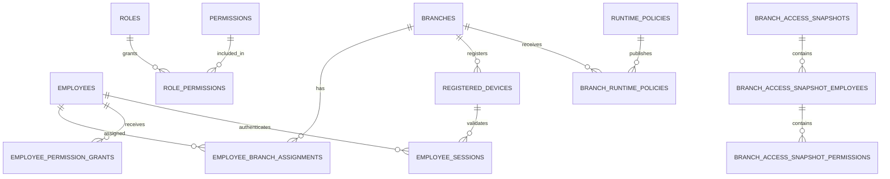
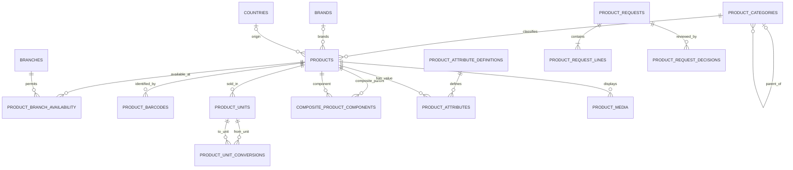
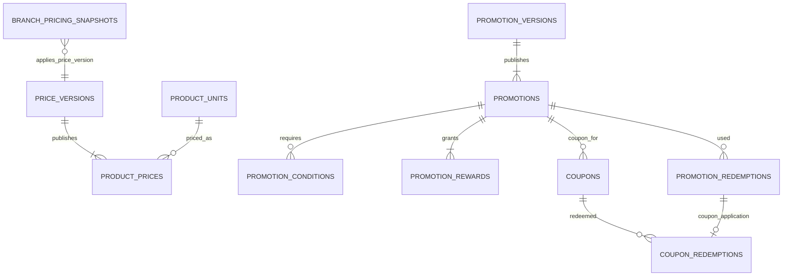
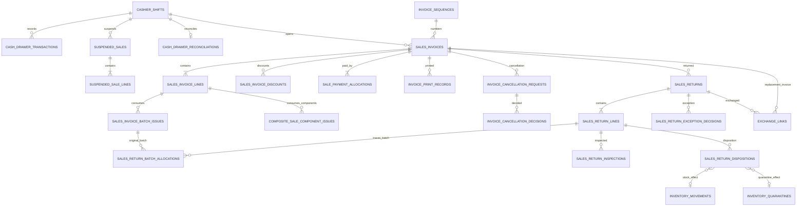
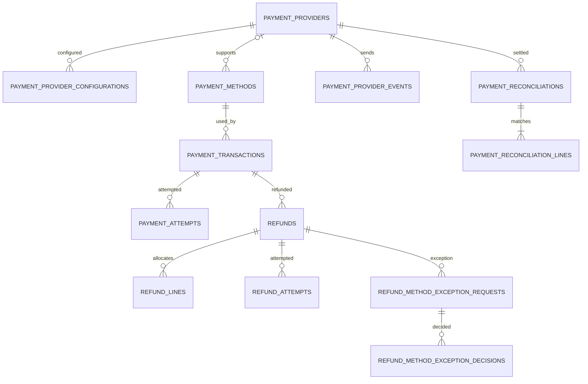
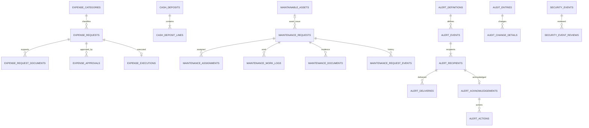

# TD-25 — Module-Level Entity Relationship Diagrams

**Version:** 0.1  
**Status:** Proposed for owner review  
**Date:** 2026-11-07  
**Depends on:** TD-12 through TD-24.

## 1. Purpose and interpretation

This document converts the approved candidate inventory and logical relationship catalogue into readable module-level ER diagrams. It is a review aid before physical SQL design; it does not replace TD-14 cardinalities or the detailed table definitions in TD-15–TD-23.

- Diagram entities represent tables in TD-13 and their detailed definitions.
- A relationship line represents a logical relationship. It is a SQL FK only when both entities are stored in the same physical database.
- Cross-database relationships are GUID correlations carried by APIs, commands, Outbox/Inbox messages and durable acknowledgements. They are never cross-database SQL FKs.
- Central-owned data and Branch-owned operational data remain separate authorities as described in TD-13/TD-24.
- Some secondary/reference relationships are omitted from the diagrams for readability; TD-14 remains the exhaustive relationship catalogue.

## 2. Organization and access ERD

**Authority:** Branches, employees, roles, permissions, devices and runtime policy are centrally governed. Branch access snapshots and runtime policy copies are local projections.

## 3. Product catalog ERD

**Authority:** Central owns the catalogue. Branches consume approved read-only projections. Supplier identifiers/prices and selling prices are owned by Procurement and Pricing, not Catalog.

## 4. Suppliers and procurement ERD

```mermaid
erDiagram
    SUPPLIERS ||--o{ SUPPLIER_CONTACTS : has
    SUPPLIERS ||--o{ SUPPLIER_PRODUCT_TERMS : defines
    SUPPLIERS ||--o{ SUPPLIER_PRODUCT_PRICES : quotes
    SUPPLIERS ||--o{ SUPPLIER_PRODUCT_IDENTIFIERS : identifies
    SUPPLIERS ||--o{ SUPPLIER_RETURN_TERMS : agrees
    PURCHASE_REQUESTS ||--|{ PURCHASE_REQUEST_LINES : contains
    PURCHASE_REQUESTS ||--o{ PURCHASE_REQUEST_DECISIONS : decided
    PURCHASE_REQUEST_DECISIONS ||--|{ PURCHASE_REQUEST_DECISION_LINES : resolves
    SUPPLIERS ||--o{ PURCHASE_ORDERS : receives
    PURCHASE_ORDERS ||--|{ PURCHASE_ORDER_LINES : contains
    PURCHASE_ORDERS ||--o{ PURCHASE_RECEIPTS : received
    PURCHASE_RECEIPTS ||--|{ PURCHASE_RECEIPT_LINES : contains
    PURCHASE_RECEIPTS ||--o{ PURCHASE_RECEIPT_DECISIONS : reviewed
    PURCHASE_RECEIPT_DECISIONS ||--|{ PURCHASE_RECEIPT_DECISION_LINES : resolves
    SUPPLIER_INVOICES ||--|{ SUPPLIER_INVOICE_LINES : contains
    SUPPLIER_INVOICE_LINES ||--o{ SUPPLIER_INVOICE_MATCH_LINES : matched
    SUPPLIER_INVOICES ||--o{ SUPPLIER_INVOICE_DISCREPANCIES : flags
    SUPPLIER_INVOICES ||--o{ SUPPLIER_INVOICE_DUE_DATES : due
    SUPPLIER_INVOICES ||--o{ SUPPLIER_PAYMENTS : settled_by
    SUPPLIER_RETURNS ||--|{ SUPPLIER_RETURN_LINES : contains
    SUPPLIER_RETURNS ||--o{ SUPPLIER_RETURN_EVENTS : progresses
    SUPPLIER_RETURNS ||--o{ SUPPLIER_RETURN_SETTLEMENTS : compensated
```

**Authority:** Central owns supplier master, approval, purchase orders, invoice matching/payment and supplier-return decisions. Branches originate requests and record actual receiving/return execution. Actual batch cost is owned by Branch Inventory.

## 5. Inventory and stock ERD

```mermaid
erDiagram
    WAREHOUSES ||--|{ WAREHOUSE_LOCATIONS : contains
    INVENTORY_BATCHES ||--o{ INVENTORY_BALANCES : balanced_at
    WAREHOUSE_LOCATIONS ||--o{ INVENTORY_BALANCES : holds
    INVENTORY_MOVEMENTS ||--|{ INVENTORY_MOVEMENT_LINES : contains
    INVENTORY_BATCHES ||--o{ INVENTORY_MOVEMENT_LINES : issued_or_received
    STOCK_RESERVATIONS ||--o{ STOCK_RESERVATION_ALLOCATIONS : allocates
    INVENTORY_BATCHES ||--o{ STOCK_RESERVATION_ALLOCATIONS : reserved_from
    WAREHOUSE_LOCATIONS ||--o{ STOCK_RESERVATION_ALLOCATIONS : located_at
    STOCKTAKES ||--|{ STOCKTAKE_SCOPE_LINES : scopes
    STOCKTAKES ||--o{ STOCKTAKE_ASSIGNMENTS : assigns
    STOCKTAKE_SCOPE_LINES ||--o| STOCKTAKE_LINES : first_count
    STOCKTAKE_ASSIGNMENTS ||--o{ STOCKTAKE_LINES : assigned_count
    STOCKTAKE_LINES ||--o{ STOCKTAKE_RECOUNTS : recounted
    STOCKTAKE_SCOPE_LINES ||--o| STOCKTAKE_VARIANCE_CASES : variance
    STOCKTAKE_VARIANCE_CASES ||--o{ STOCKTAKE_VARIANCE_DECISIONS : decided
    STOCKTAKES ||--o{ STOCKTAKE_SESSION_EVENTS : records
    STOCKTAKES ||--o{ STOCKTAKE_FREEZE_ACKNOWLEDGEMENTS : frozen_at
    STOCKTAKES ||--o{ STOCKTAKE_LOCKS : branch_scoped_lock
    STOCK_TRANSFERS ||--|{ STOCK_TRANSFER_LINES : contains
    STOCK_TRANSFERS ||--o{ STOCK_TRANSFER_EVENTS : progresses
    STOCK_TRANSFERS ||--o{ STOCK_TRANSFER_BRANCH_EVENTS : acknowledged
    INVENTORY_BATCHES ||--o{ INVENTORY_QUARANTINES : quarantined
    INVENTORY_QUARANTINES ||--o{ INVENTORY_DISPOSAL_REQUESTS : requested
    INVENTORY_DISPOSAL_REQUESTS ||--|{ INVENTORY_DISPOSAL_REQUEST_LINES : contains
    INVENTORY_DISPOSAL_REQUESTS ||--o{ INVENTORY_DISPOSAL_DECISIONS : decided
    INVENTORY_DISPOSAL_DECISIONS ||--|{ INVENTORY_DISPOSAL_DECISION_LINES : resolves
    INVENTORY_DISPOSALS ||--|{ INVENTORY_DISPOSAL_LINES : contains
    REORDER_POLICIES ||--o{ STOCK_INCREASE_REQUESTS : guides
    STOCK_INCREASE_REQUESTS ||--o{ STOCK_INCREASE_REQUEST_DECISIONS : decided
    EXPIRY_ALERT_POLICIES ||--o{ INVENTORY_BATCHES : evaluates
```

**Authority:** Each Branch owns its physical batches, balances, movement ledger, reservation acceptance, quarantine and disposal execution. Central owns stocktake/transfer/disposal decisions and replenishment policies. Central receives projections and acknowledgements.

## 6. Pricing, promotions and coupons ERD

**Authority:** Central owns price and promotion versions. Branch snapshots are read-only. Branch POS redemption events are durable and synchronized; global usage limits during disconnected Offline operation remain a technical gate in TD-24.

## 7. POS, sales, invoices, returns and exchanges ERD

**Authority:** Branch owns completed invoices, shifts, drawers, returns and physical inspection/disposition facts. Central owns paid-invoice cancellation and no-original-invoice return exception decisions. Payments and Inventory own their respective financial/stock records.

## 8. Payments and refunds ERD

**Authority:** Online payments, provider events/configuration, electronic refunds and provider reconciliation are Central-owned. POS transaction origins and permitted cash refunds are Branch-owned. Provider confirmation is trusted only after server-side verification.

## 9. Online orders, customer, loyalty and fulfillment ERD

```mermaid
erDiagram
    CUSTOMERS ||--o{ CUSTOMER_PHONE_VERIFICATIONS : verifies
    CUSTOMERS ||--o{ CUSTOMER_DUPLICATE_RESOLUTIONS : canonical_customer
    CUSTOMERS ||--o| CUSTOMER_DUPLICATE_RESOLUTIONS : duplicate_customer
    CUSTOMERS ||--o{ CARTS : owns
    CARTS ||--|{ CART_LINES : contains
    CUSTOMERS ||--o{ ORDERS : places
    ORDERS ||--|{ ORDER_LINES : contains
    ORDERS ||--o{ ORDER_STATUS_HISTORY : changes
    ORDERS ||--o| ORDER_RESERVATIONS : reserves
    ORDERS ||--o| ORDER_DELIVERY_DETAILS : addresses
    DELIVERY_CITIES ||--o{ DELIVERY_AREAS : contains
    DELIVERY_AREAS ||--o{ DELIVERY_FEE_RULES : fee_history
    DELIVERY_AREAS o|--o{ FREE_DELIVERY_RULES : free_delivery_scope
    ORDERS ||--o{ ORDER_NOTIFICATIONS : notifies
    ORDER_NOTIFICATIONS ||--o{ NOTIFICATION_DELIVERY_ATTEMPTS : attempts
    ORDERS ||--o{ ORDER_CANCELLATION_REQUESTS : cancellation
    ORDER_CANCELLATION_REQUESTS ||--o{ ORDER_CANCELLATION_DECISIONS : decided
    ORDER_CANCELLATION_DECISIONS ||--|{ ORDER_CANCELLATION_DECISION_LINES : dispositions
    ORDERS ||--o{ FULFILLMENT_TASKS : fulfilled
    FULFILLMENT_TASKS ||--o{ PICKING_SESSIONS : picked
    FULFILLMENT_TASKS ||--o{ FULFILLMENT_EXCEPTIONS : exception
    FULFILLMENT_EXCEPTIONS ||--o{ FULFILLMENT_EXCEPTION_DECISIONS : decided
    FULFILLMENT_EXCEPTION_DECISIONS ||--|{ FULFILLMENT_EXCEPTION_DECISION_LINES : resolves
    PICKING_SESSIONS ||--|{ PICKING_LINES : contains
    PICKING_LINES ||--o{ PICKING_LINE_SCANS : verifies
    DELIVERY_SHIFT_COORDINATORS ||--o{ DELIVERY_ASSIGNMENTS : coordinates
    FULFILLMENT_TASKS ||--o{ DELIVERY_ASSIGNMENTS : assigned
    DELIVERY_ASSIGNMENTS ||--o| DELIVERY_ATTEMPTS : attempt
    DELIVERY_ATTEMPTS ||--o{ DELIVERY_PROOFS : proof
    DELIVERY_ATTEMPTS ||--o| FAILED_DELIVERY_RETURNS : failed_return
    FAILED_DELIVERY_RETURNS ||--|{ FAILED_DELIVERY_RETURN_LINES : contains
    FAILED_DELIVERY_RETURN_LINES ||--o{ DELIVERY_RETURN_INSPECTIONS : inspected
    ORDERS ||--o{ DELIVERY_DISPUTES : disputed
    DELIVERY_DISPUTES ||--o{ DELIVERY_DISPUTE_DECISIONS : decided
    FULFILLMENT_TASKS ||--o| PICKUP_HANDOVERS : picked_up
    PICKUP_RETENTION_POLICIES ||--o{ PICKUP_NON_COLLECTION_CASES : governs
    PICKUP_NON_COLLECTION_CASES ||--o{ PICKUP_NON_COLLECTION_DECISIONS : decided
    CUSTOMERS ||--o| LOYALTY_ACCOUNTS : has
    LOYALTY_PROGRAM_RULES ||--o{ LOYALTY_POINT_TRANSACTIONS : rule_version
    LOYALTY_ACCOUNTS ||--o{ LOYALTY_POINT_TRANSACTIONS : ledger
    LOYALTY_POINT_TRANSACTIONS ||--o| LOYALTY_POINT_LOTS : earns
    LOYALTY_POINT_LOTS ||--o{ LOYALTY_POINT_LOT_ALLOCATIONS : allocated
    LOYALTY_POINT_TRANSACTIONS ||--o{ LOYALTY_POINT_LOT_ALLOCATIONS : consumes_or_restores
    CUSTOMERS ||--o{ CUSTOMER_COMPLAINTS : raises
    CUSTOMER_COMPLAINTS ||--o{ COMPLAINT_ASSIGNMENTS : assigned
    CUSTOMER_COMPLAINTS ||--o{ COMPLAINT_ACTIONS : actions
    PICKUP_NON_COLLECTION_CASES ||--o{ PICKUP_NON_COLLECTION_DECISIONS : decided
```

**Authority:** Central owns customer profiles, online order state, loyalty ledger/rules, complaints, assignments, disputes and pickup retention decisions. Branch stores assigned-order execution data only. Delivery attempt uniqueness is one per OrderId.

## 10. Operations, maintenance, alerts, audit and reporting ERD

**Authority:** Central owns approvals, deposits, maintenance workflow, alert policy, security review and management reporting. Branch owns request origins and local operational evidence. Audit/security facts may originate locally and synchronize to Central.

## 11. Synchronization infrastructure boundary

TD-12 defines five infrastructure tables: `sync.OutboxMessages`, `sync.InboxMessages`, `sync.ProcessedOperations`, `sync.BranchCommands` and `sync.SyncCheckpoints`. They support delivery, idempotency, commands and stream progress. Their detailed physical constraints remain in TD-12; this ERD package does not add generic duplicate messaging tables.

## 12. ERD review findings and technical checks

1. Table names and core relationship paths are aligned with TD-13/TD-14 and detailed schemas TD-15–TD-23.
2. No diagram line authorizes a cross-database FK. Where entities are in different databases, the relationship is a GUID correlation and synchronization contract.
3. The one-to-one Order → OrderReservation cardinality is intentional; one confirmed checkout has one 15-minute reservation.
4. Product price is linked to ProductUnit; supplier purchase price remains Procurement-owned; actual inventory cost remains batch-owned.
5. Stocktake variance and disposal decisions have per-line child rows where quantities can differ by item.
6. Returns link to original invoice lines and original batch issues; returned goods require inspection before stock disposition.
7. Loyalty points are an immutable ledger with expiring earned lots; account balance is only a projection.
8. Payment/refund/order/invoice/return/fulfillment states remain separate; no status field is reused across domains.
9. All 205 domain PK declarations and five synchronization PK declarations are Guid/uniqueidentifier.

## 13. Approval boundary and next step

TD-25 is the module-level ERD package for owner review. After approval, the next work is to resolve the implementation-impacting technical items in TD-24 and create the physical SQL Server design package: exact column types/lengths/defaults, filtered/unique indexes, check constraints, delete behaviors, concurrency/locking strategy, partition/retention choices and EF Core mapping conventions.

**No SQL table, EF Core entity, DDL or migration is created by this document.**
